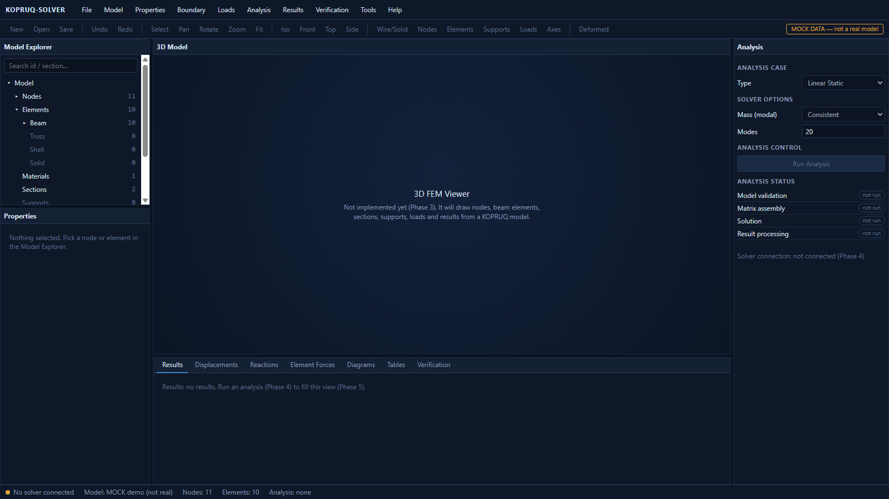

# KOPRUQ-SOLVER UI (React) — Phase 2: GUI foundation

React + TypeScript + Vite front end for KOPRUQ-SOLVER. **This phase is a skeleton only**: layout,
menus, toolbar and panels. Nothing is connected to the C++ solver yet, and every unimplemented
command is disabled (with a tooltip naming the phase that will provide it). The model shown in the
Model Explorer is **MOCK data** (`src/mock/demoModel.ts`), marked as such in the toolbar and status bar.
The existing C++ core, JSON schemas, CLI and the Qt6 GUI are untouched.



## Run in the browser

Requires Node 20+ (tested with Node 24, npm 11).

```
cd ui
npm install
npm run dev          # http://127.0.0.1:5173
```

Other commands: `npm test` (vitest), `npm run typecheck`, `npm run build` (output in `dist/`),
`npm run preview` (serve the build).

## Layout

| Area | Component |
|---|---|
| Top menu, toolbar, status bar | `src/app/MenuBar.tsx`, `Toolbar.tsx`, `Shell.tsx` |
| Left: tree + search | `components/model-explorer` |
| Left bottom: properties | `components/properties-inspector` |
| Centre: 3D viewer (placeholder) | `components/fem-viewer` |
| Right: analysis controls | `components/analysis-controls` |
| Bottom: result tabs + Verification | `components/results-viewer`, `components/verification-panel` |

Panels resize by dragging the splitters. Reusable components (`src/components/*`) import nothing from
Tauri; the outside world is reached only through `src/platform/SolverHost.ts` (Tauri implementation: Phase 4).

## Phases

2 foundation (this) · 3 FEM viewer (vtk.js vs three.js evaluation first) · 4 solver connection through
Tauri + new CLI commands · 5 results · 6 verification workspace (MIDAS NX comparison stays in C++) ·
7 packaging · 8 Qt6 retirement plan.
