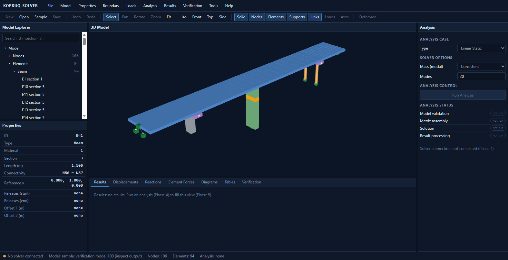

# KOPRUQ-SOLVER UI (React) — Phase 2: GUI foundation

React + TypeScript + Vite front end for KOPRUQ-SOLVER. **This phase is a skeleton only**: layout,
menus, toolbar and panels. Nothing is connected to the C++ solver yet, and every unimplemented
command is disabled (with a tooltip naming the phase that will provide it). The model shown in the
Model Explorer is **MOCK data** (`src/mock/demoModel.ts`), marked as such in the toolbar and status bar.
The existing C++ core, JSON schemas, CLI and the Qt6 GUI are untouched.



## Phase 3 status: FEM viewer (vtk.js)

Reads a **`kopruq-model-view`** JSON written by the solver CLI (no analysis involved):

```
kopruq_solver_cli inspect model.json -o view.json                       # native kopruq-model
kopruq_solver_cli inspect midas.json --format midas-nx-json -o view.json # MIDAS NX export
```

Then **Open** in the toolbar / File menu (or **Sample**, a real inspect output of verification model 100;
`http://127.0.0.1:5173/?sample` opens it at start-up).

Working: members drawn as section solids (section outlines extruded along the solver's own member axes,
offsets applied) or as lines, nodes, support glyphs, elastic and rigid links, camera presets (Iso, Front,
Top, Side, Fit; drag = rotate, Shift+drag = pan, wheel = zoom), click selection of elements, nodes and
supports (GPU picking) synchronised with the Model Explorer and Properties, show/hide toggles.
Not implemented (disabled, with the phase named): loads, local axes, deformed shape and result colouring
(Phase 5), analysis (Phase 4), verification (Phase 6), editing.

Tests: `npm test` -- geometry (member axes, ear clipping, extrusion volumes, support glyphs, all on the
real model-100 data) and shell behaviour. Click picking in a real browser was checked with a DevTools
script (`spikes/cdp_pick.mjs`, 16/16 on model 100); viewer timings are in `docs/viewer-evaluation.md`.

## Layout

| Area | Component |
|---|---|
| Top menu, toolbar, status bar | `src/app/MenuBar.tsx`, `Toolbar.tsx`, `Shell.tsx` |
| Left: tree + search | `components/model-explorer` |
| Left bottom: properties | `components/properties-inspector` |
| Centre: 3D viewer | `components/fem-viewer` (vtk.js), pure geometry in `src/model/geometry.ts` |
| Right: analysis controls | `components/analysis-controls` |
| Bottom: result tabs + Verification | `components/results-viewer`, `components/verification-panel` |

Reusable components import nothing from Tauri; the outside world is reached only through
`src/platform/SolverHost.ts` (Tauri implementation: Phase 4).

## Phases

2 foundation (done) · 3 FEM viewer (this) · 4 solver connection through Tauri + new CLI commands ·
5 results · 6 verification workspace (MIDAS NX comparison stays in C++) · 7 packaging · 8 Qt6 retirement plan.
